<picture>
  <source media="(prefers-color-scheme: dark)" srcset="./assets/banner-dark.svg">
  
</picture>

Senior software engineer. I build and maintain developer tooling for Laravel and event
sourcing, and I write about Laravel, developer tools, and AI-assisted coding with Claude Code.

### 📬 Newsletter

Subscribe and get my free Spatie Event Sourcing cheat sheet (printable PDF), plus practical notes on Laravel and AI-assisted development, roughly once a month. No spam.

**[Get the cheat sheet →](https://albertoarena.it/subscribe/?utm_source=github&utm_medium=profile&utm_campaign=newsletter&utm_content=albertoarena)**

## Currently

- Shipping [**Truss**](https://github.com/albertoarena/laravel-truss), a live ER diagram of your Laravel schema, safe to run against production. It exports the schema as grounding context for a coding agent, over an optional read-only MCP server, and `truss:doctor` reviews the structure for problems and can fail your CI build. Structure only, never data. [Docs](https://trussphp.com/?utm_source=github&utm_medium=profile&utm_campaign=bio)
- Bringing Spatie event sourcing into Filament v4 with [**filament-event-sourcing**](https://github.com/albertoarena/filament-event-sourcing).
- Working out how far a Claude Code skill can replace a code generator, in [**claude-laravel-event-sourcing**](https://github.com/albertoarena/claude-laravel-event-sourcing).
- Available for freelance and consulting work. [Here is what that looks like](https://albertoarena.it/pages/consulting/?utm_source=github&utm_medium=profile&utm_campaign=consulting).

## What I maintain

**Laravel**

- [laravel-truss](https://github.com/albertoarena/laravel-truss) reads your schema and draws it as a scrollable, zoomable ER diagram.
- [filament-truss](https://github.com/albertoarena/filament-truss) puts the Truss diagram of your real database inside a Filament panel.
- [homebrew-truss](https://github.com/albertoarena/homebrew-truss) is the Homebrew tap for the standalone Truss binary: schema viewer, ER diagram and schema doctor.
- [codemetry-laravel](https://github.com/albertoarena/codemetry-laravel) brings git-powered code quality metrics to a Laravel app.

**Event sourcing**

- [laravel-event-sourcing-generator](https://github.com/albertoarena/laravel-event-sourcing-generator) scaffolds a whole Spatie domain from one Artisan command.
- [filament-event-sourcing](https://github.com/albertoarena/filament-event-sourcing) writes through aggregates, browses stored events, and replays projectors from a Filament panel.

**Claude Code**

- [claude-laravel-event-sourcing](https://github.com/albertoarena/claude-laravel-event-sourcing) designs and generates event-sourced domain code for you.
- [claude-code-laravel-starter](https://github.com/albertoarena/claude-code-laravel-starter) is a lean docs skeleton for Laravel. CLAUDE.md is RAM, docs/ is disk.

**Sites and apps**

- [PHP Lives](https://phplives.dev/) lists real things people shipped with PHP in the last six months. [Source](https://github.com/albertoarena/phplives.dev)
- [Cogway](https://cogway.dev/?utm_source=github&utm_medium=profile&utm_campaign=projects) has interactive explainers for Laravel and PHP.
- [Sudo Play](https://sudoplay.dev/?utm_source=github&utm_medium=profile&utm_campaign=projects) is a macOS menu bar app that picks today's Spotify playlist from what you are coding and how you feel about it. [Source](https://github.com/albertoarena/sudo-play)
- [tryJev](https://tryjev.albertoarena.it/?utm_source=github&utm_medium=profile&utm_campaign=projects) is an unofficial demo for Jev, a TypeSafe AI model that answers typed questions with calibrated probabilities.

Smaller tools

- [envaudit](https://github.com/albertoarena/envaudit) validates `.env` files in a pipeline. Zero dependencies.
- [laravel-netsons-deploy](https://github.com/albertoarena/laravel-netsons-deploy) deploys a Laravel app to Netsons shared hosting from a GitHub Action.
- [github-traffic-badge](https://github.com/albertoarena/github-traffic-badge) turns repository traffic into a badge.

[All projects](https://albertoarena.it/projects/?utm_source=github&utm_medium=profile&utm_campaign=projects)

## Latest posts

<!-- BLOG-POST-LIST:START -->
- Oct 19, 2026 · [PHP is not dead. Here is what people shipped](https://albertoarena.it/posts/php-is-not-dead-here-is-what-people-shipped/)
- Oct 15, 2026 · [What I Learned From My First Claude Code Cloud Sessions](https://albertoarena.it/posts/what-i-learned-from-my-first-claude-code-cloud-sessions/)
- Oct 8, 2026 · [The Last Man Who Could Read Code: A Short Story](https://albertoarena.it/posts/the-last-man-who-could-read-code/)
- Oct 5, 2026 · [The Sound of Silence: What Your AI Agent Does Not Tell You](https://albertoarena.it/posts/the-sound-of-silence/)
- Sep 30, 2026 · [Prompt Injection Is a Laravel Problem Now](https://albertoarena.it/posts/prompt-injection-is-a-laravel-problem-now/)<!-- BLOG-POST-LIST:END -->

[Read all posts on my blog](https://albertoarena.it/?utm_source=github&utm_medium=profile&utm_campaign=bio&utm_content=posts) · [RSS](https://albertoarena.it/rss.xml)

---

[albertoarena.it](https://albertoarena.it/?utm_source=github&utm_medium=profile&utm_campaign=bio&utm_content=footer) · [dev/null](https://dev-null.sh/@albertoarena) · [@alberto_arena](https://x.com/alberto_arena) · [LinkedIn](https://www.linkedin.com/in/alberto-arena-ba44a624/) · [YouTube](https://www.youtube.com/@AlbertoArenaDev)
